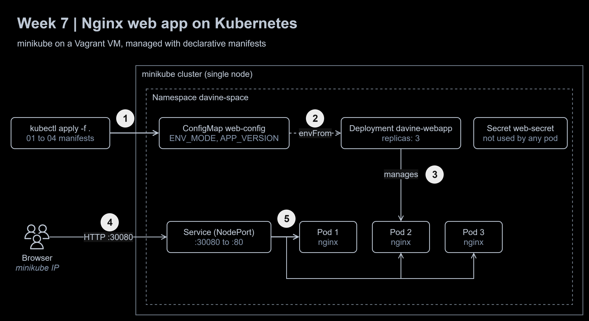
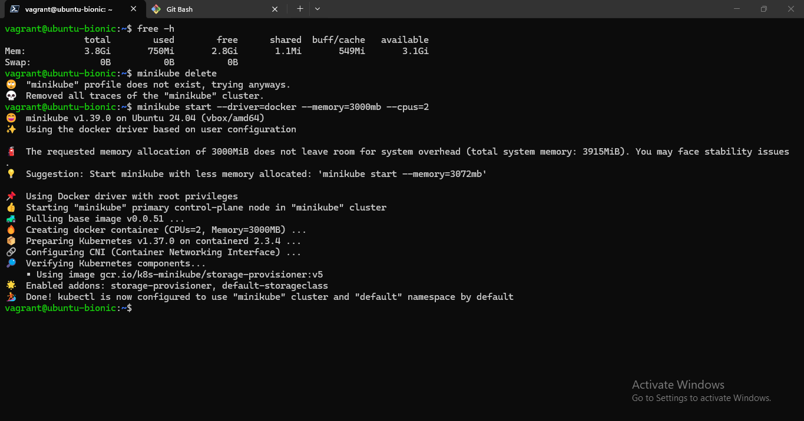
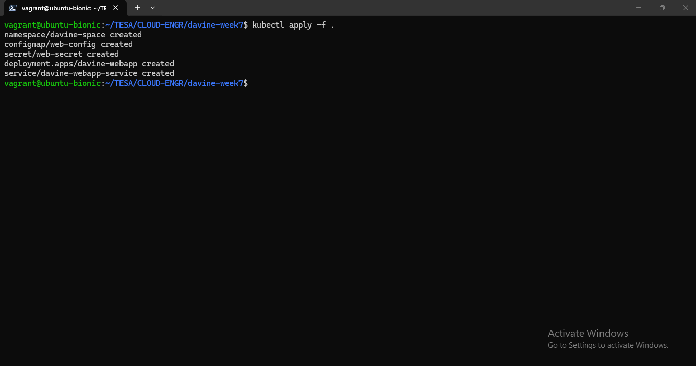
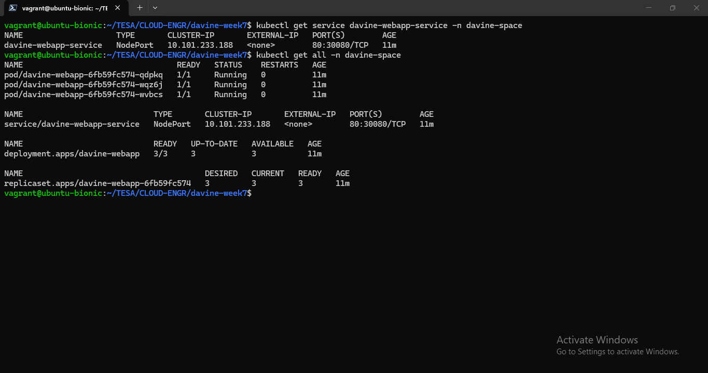
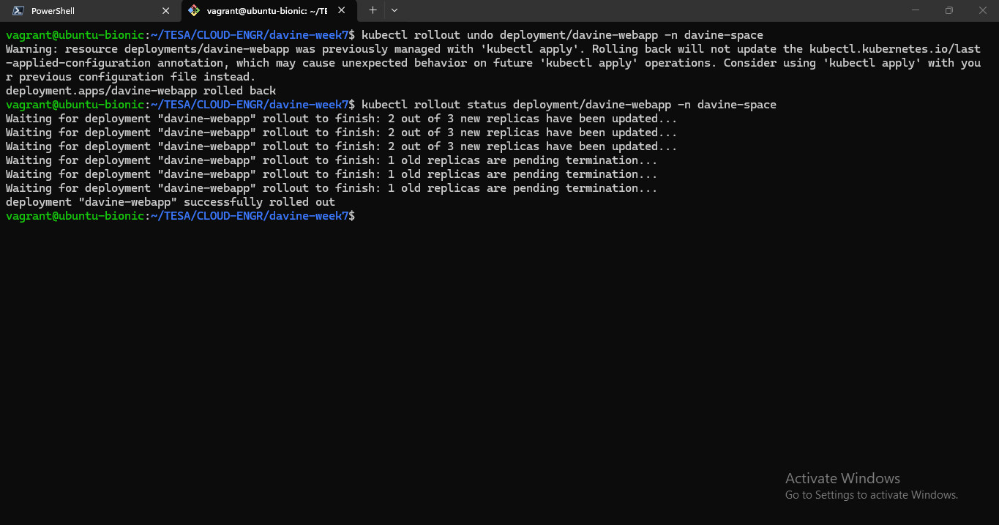

# Kubernetes Container Orchestration on minikube


**Lab date:** September 2026 | **Type:** Davine Technologies Internship Project, DevOps internship week 7 lab | **Status:** complete

> **Evaluation project.** A learning task completed for the Davine Technologies internship programme. Everything ran on a single-node minikube cluster inside a local Vagrant VM, and the Secret holds a placeholder value. It is not a production deployment and contains no company data.

**At a glance**

- **Outcome:** an Nginx web app runs as three replicas that Kubernetes keeps alive, scales on command, updates without downtime and rolls back with one command.
- **Built:** four declarative manifests (a namespace, a ConfigMap, a Secret, and a Deployment with a NodePort Service) and 19 screenshots of every step.
- **Stack:** Kubernetes (minikube), kubectl, Nginx 1.21.0 and 1.22.0 images, YAML, Vagrant, Ubuntu.
- **Proof:** the screenshots show three pods running, a scale to five replicas and back to three, a rolling update from `nginx:1.21.0` to `nginx:1.22.0`, and `kubectl rollout undo` ending with `deployment "davine-webapp" successfully rolled out`. The Nginx page loaded through NodePort 30080.



To zoom in, right-click the diagram and open the image in a new tab. The editable source is [`docs/diagrams/minikube-webapp.drawio`](docs/diagrams/minikube-webapp.drawio).

1. **`kubectl apply -f .`** creates the namespace `davine-space` and everything in it from the four manifests.
2. The **Deployment** loads `ENV_MODE` and `APP_VERSION` from the **ConfigMap** into each container with `envFrom`.
3. The Deployment keeps **three pods** of `nginx:1.21.0` running, replacing any that die.
4. A **browser** opens the minikube IP on port 30080.
5. The **NodePort Service** forwards that traffic to port 80 on whichever pod is ready.

## The task, in my own words

Deploy a containerised web app on Kubernetes using manifests rather than one-off commands: isolate it in a namespace, keep configuration outside the image, expose it to a browser, then practise the day-two operations that make orchestration worth having: scaling, rolling updates and rollbacks.

## What I did in the lab

1. **Started a minikube cluster** on an Ubuntu Vagrant VM and confirmed the node was ready.

   

2. **Wrote the manifests** as code: [`01-namespace.yaml`](01-namespace.yaml), [`02-configmap.yaml`](02-configmap.yaml), [`03-secret.yaml`](03-secret.yaml) and [`04-app.yaml`](04-app.yaml), then applied them in one command.

   

3. **Checked what was created** and opened the app in a browser through the NodePort.

   

4. **Operated it:** scaled to five replicas and back to three, rolled the image forward to `nginx:1.22.0`, and rolled it back.

   

More evidence: [cluster status](Screenshots/kubernetes-cluster-status.png), [creating the manifests](Screenshots/create-kubernetes-manifests.png), the [namespace](Screenshots/namespace-yaml.png), [ConfigMap](Screenshots/configmap-yaml.png), [Secret](Screenshots/secret-yaml.png) and [app](Screenshots/app-yaml.png) files, [ConfigMap and Secret](Screenshots/kubectl-get-configmap-secret.png), [Deployment](Screenshots/kubectl-get-deployment.png), [pods](Screenshots/kubectl-get-pods.png), [service URL](Screenshots/minikube-service-url.png), [Nginx in the browser](Screenshots/nginx-welcome-browser.png), [scale up](Screenshots/kubectl-scale-deployment-up.png), [scale down](Screenshots/kubectl-scale-deployment-down.png), [set image](Screenshots/kubectl-set-image.png), [restart and re-apply](Screenshots/minikube-start-reapply.png).

## Running it

```bash
minikube start
kubectl apply -f .
kubectl get all -n davine-space
minikube service davine-webapp-service -n davine-space --url     # open the printed URL
kubectl scale deployment/davine-webapp -n davine-space --replicas=5
kubectl set image deployment/davine-webapp -n davine-space nginx=nginx:1.22.0
kubectl rollout undo deployment/davine-webapp -n davine-space
kubectl delete namespace davine-space                              # clean up
```

## How it is tested

| Check | What it shows | Result |
|---|---|---|
| `kubectl get deployment` and `get pods` | the desired three replicas are running and ready | 3 of 3 ready |
| Browser on NodePort 30080 | the Service selects the pods and routes traffic to port 80 | Nginx welcome page |
| `kubectl scale` to 5, then to 3 | the Deployment converges on any replica count | 5 pods, then 3 |
| `kubectl set image` then `rollout undo` | rolling update and rollback replace pods gradually | `successfully rolled out` |

## Mistakes I fixed

1. **The first README called the Secret secure.** It said the Secret "securely stores sensitive data". A Secret written in a committed manifest is plain text in git, and Kubernetes only base64-encodes it. The value here is a placeholder, and this README now says so, with the production approach in the table below.
2. **The company name was misspelled** as "Davine Technology". It is Davine Technologies.

## Found on review

These came up when I reread the work in November 2026. The manifests stay as I delivered them, so the record of the lab is unchanged.

- **The Secret is never used.** `03-secret.yaml` creates `web-secret`, but no pod mounts it or reads it as an environment variable, so it demonstrates the object, not its use.
- **Imperative changes drift from git.** `kubectl rollout undo` warned that the Deployment was managed with `kubectl apply`. Scaling, `set image` and `undo` change the live object without changing `04-app.yaml`. The durable way is to edit the manifest and apply it again.

## Lab vs production

| Concern | In this lab | Before going to production | Well-Architected pillar |
|---|---|---|---|
| Secrets | a placeholder in a committed manifest | External Secrets Operator with AWS Secrets Manager, or Sealed Secrets; never plain values in git | Security |
| Exposure | NodePort 30080 on the node, plain HTTP | an Ingress or load balancer with TLS | Security |
| Health | no readiness or liveness probes | probes, so traffic only reaches pods that are ready and stuck pods restart | Reliability |
| Resources | no CPU or memory requests or limits | requests and limits on every container, a LimitRange per namespace | Performance Efficiency |
| Cluster | one minikube node | a managed cluster such as Amazon EKS with nodes across availability zones | Reliability |
| Changes | `kubectl scale`, `set image`, `undo` by hand | GitOps (Argo CD or Flux) applying the manifests from git; an HPA for scaling | Operational Excellence |
| Images | pinned tags `nginx:1.21.0` and `1.22.0` | pinned by digest and scanned before deployment | Security |

## What I learned

- **Declarative beats imperative.** Manifests say what should exist, and Kubernetes keeps making it true. Commands change the cluster and leave the files behind.
- **A Deployment is a promise.** Kill a pod and it comes back; ask for five and you get five. That self-healing is the reason to orchestrate at all.
- **Rollbacks are cheap when updates are rolling.** `rollout undo` returned to the previous ReplicaSet in seconds because the old one was still there.
- **A Secret object is not a secrets manager.** Where the value comes from matters more than the object that holds it.

## License

Released under the [MIT License](LICENSE).
